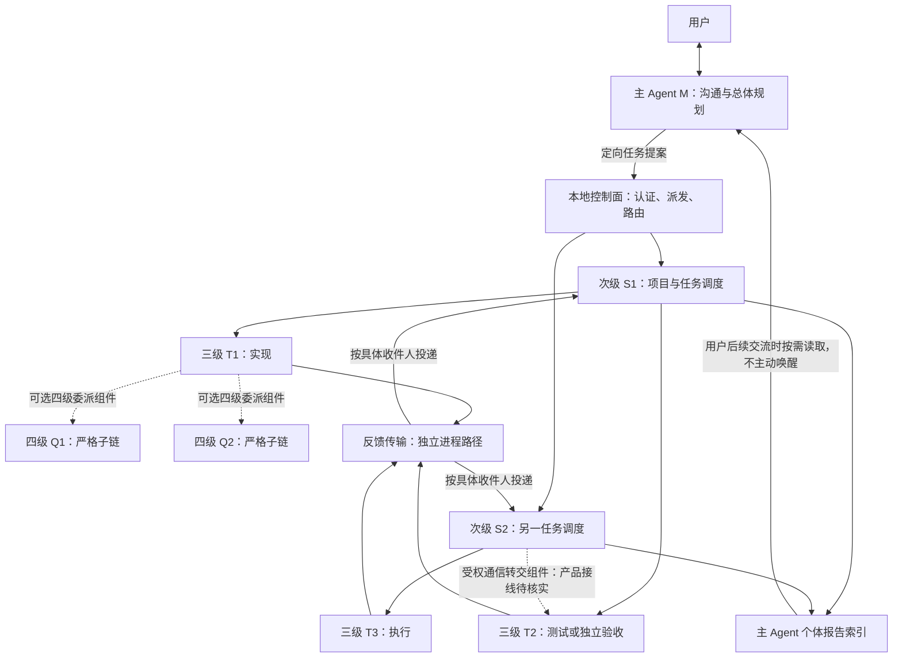
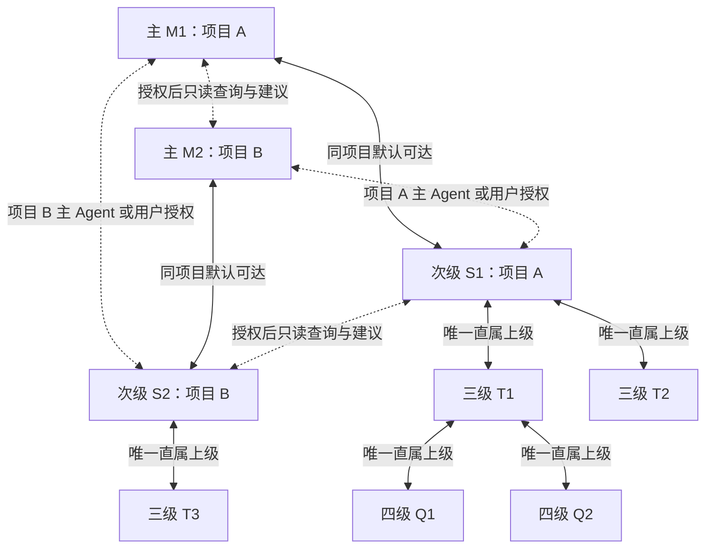

# Agent 编排与通信概览

本页承接 README 的架构图，供了解分层职责和通信边界。以下保留原图的核查范围和设计状态，**迁移不代表重新验收**；实现进度见 [计划状态](../PLAN_STATUS.md) 与 [COMM-01 任务卡](tasks/COMM01_ADDRESSABLE_UPPER_LAYER_AND_SINGLE_PARENT_TASK_CARD.md)。

## Agent 编排与通信连接图

2026-10-05 静态核查：已有分层调度、定向反馈、个体来源与四级绑定组件；**尚不能宣称主—次级全连接及全入口唯一上级已完整落地**。下图展示当前代码对应的结构与可选组件，不是所有连接均已通过产品验收。字母仅为示例，实际对象必须按不可复用的 `agentInstanceId` 寻址。

实线表示已有主要控制/报告路径，虚线表示可选组件，不能据此推断已在所有产品入口接通。反馈框是传输设施，不是额外 Agent；其扇入扇出不代表全员广播或共享记忆。SDK provider 默认独立反馈进程，显式覆盖与 mock 路径的差异仍见上方当前进展。

迁移导航说明：原文“上方当前进展”现位于 [历史能力记录](README_STATUS_ARCHIVE.md#当前进展)；最新验收情况另见 [计划状态](../PLAN_STATUS.md)。

### 新增目标：上层受控全连接，下层唯一上级（待实施）

目标图的所有边均由本地控制面和独立反馈进程路由，不是模型间直连。**同项目的主层与次级层默认全连接，不逐边申请通信授权；跨项目按需连接，须目标项目有权主 Agent 或用户授权。** 单会话仍只有一个主 Agent；同项目多个会话的主 Agent 均可定向联系本项目次级，但不共享会话历史。跨项目授权仅覆盖明确对象/范围及关联回复，可到期、撤销，不自动开放两个项目全网。全连接不表示默认广播、同层全互通、任务控制权转移或跨项目文件权限。

三级、四级执行者只向唯一直属上级请示和报告；其他 Agent 的协作请求经直属上级代理转达，保留原始来源，不额外形成指挥关系。模型不负责猜测接收者，路由由本地身份、项目/会话、任务和关系 revision 校验。任务卡：[COMM-01 上层寻址与唯一上级](tasks/COMM01_ADDRESSABLE_UPPER_LAYER_AND_SINGLE_PARENT_TASK_CARD.md)（pending，含旧转交规则迁移、测试与实施顺序）。

**所有跨项目连接仅限授权范围内的只读查询、资料交流与建议，放权模式也不例外。** 主—主、次级—次级可以申请同层建议通道；三级/四级经唯一上级代理沟通。外来 Agent 不能直接修改目标项目，也不能借建议自动触发命令、文件、配置、任务队列或 Git 变更。目标项目有权 Agent 独立采纳建议后，才按本项目权限创建任务并执行；通信许可不代替资源读取或执行授权。
